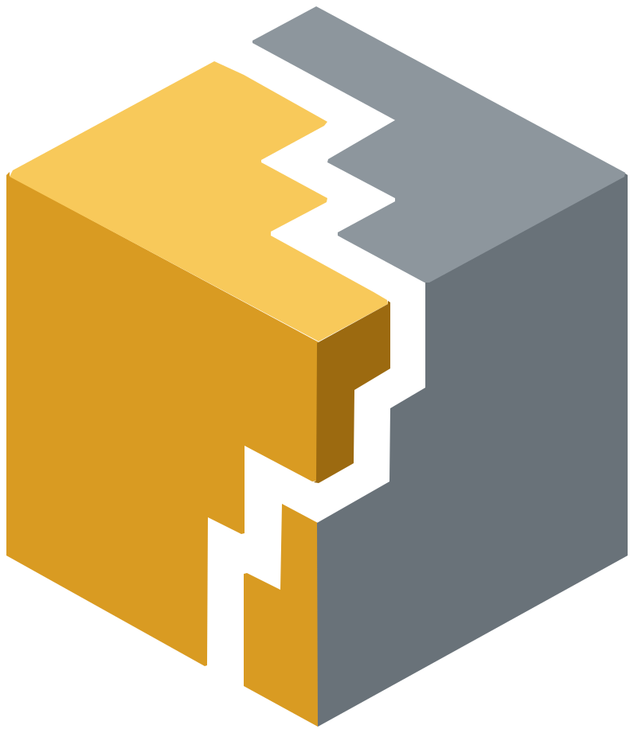
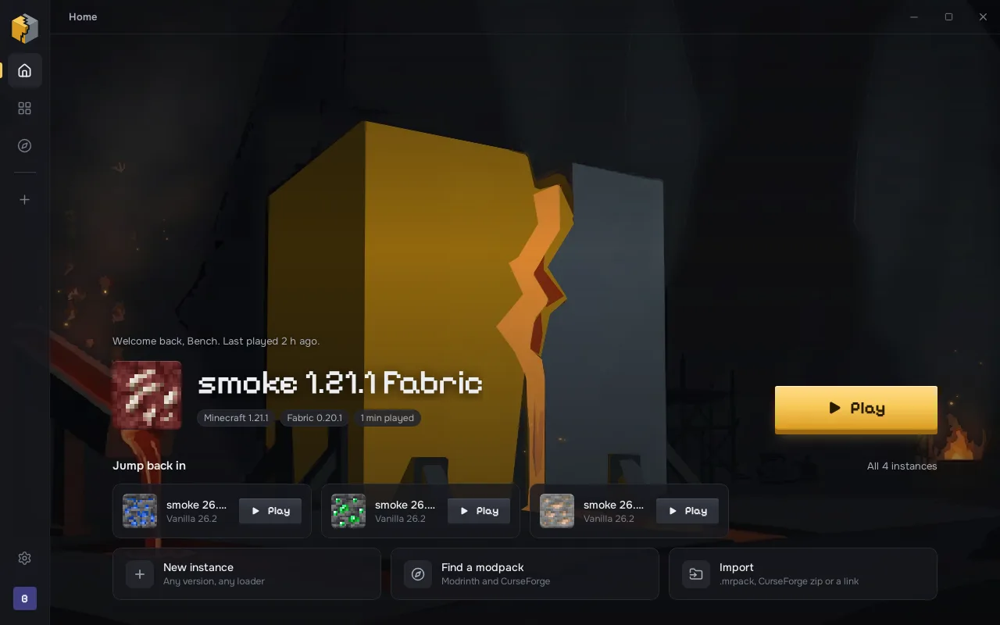
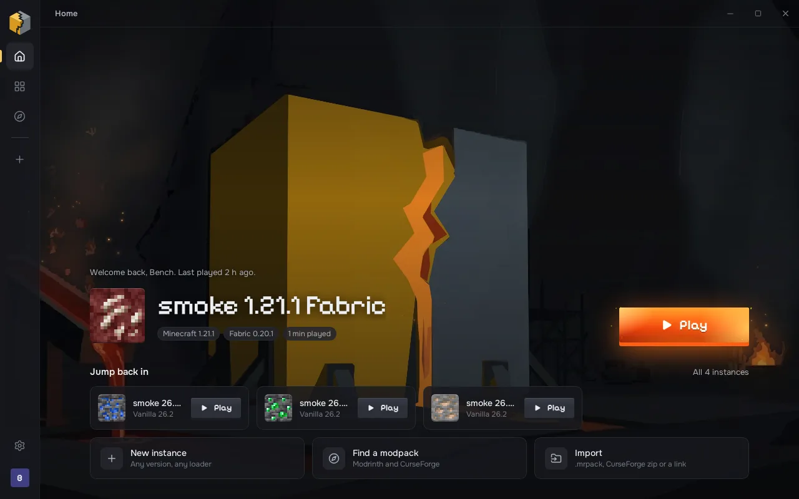
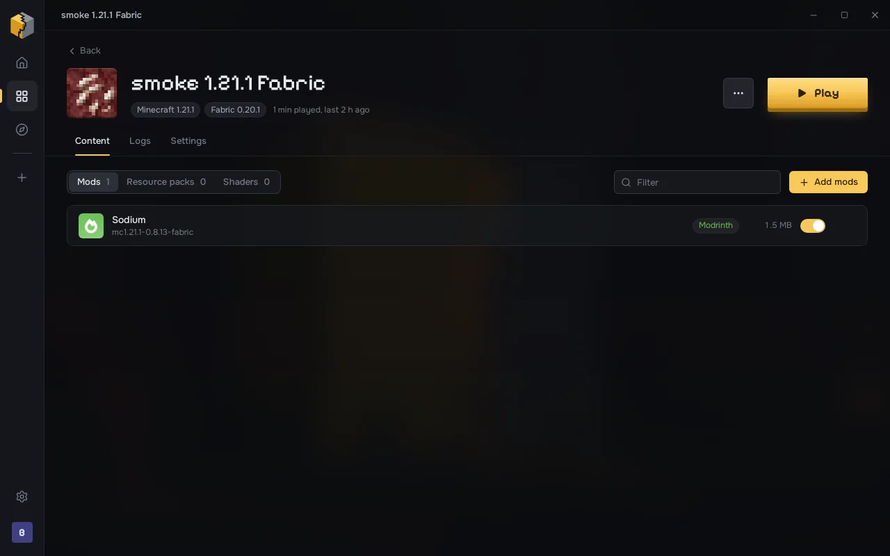
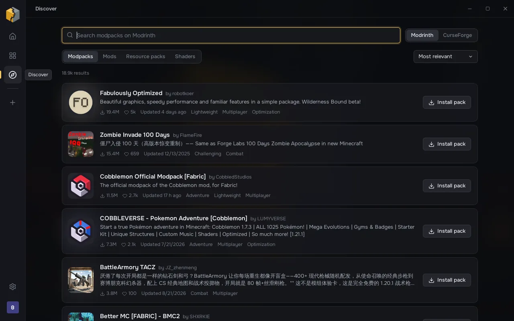

<p align="center"></p>

<h1 align="center">Alloy</h1>

<p align="center"><b>A Minecraft launcher forged for speed and feel.</b><br>
Every loader, every pack, Modrinth and CurseForge in one library.</p>

<p align="center">
  <a href="https://github.com/Elchi-dev/AlloyMC/actions/workflows/ci.yml"></a>
  
  
  
  
</p>

<p align="center"></p>

Most launchers are either fast and plain or pretty and slow. Alloy is a Rust core with a
UI that moves, and it is honest about where it is: **alpha**. Vanilla, Fabric and Quilt
install and launch; Forge and NeoForge are next. CurseForge is a work in progress.

## Meet Ori


Ori is the little star from [Orbit](https://github.com/Elchi-dev/Orbit), and in Alloy it
keeps you company: in empty places, in toasts (done for good news, oops for errors), and
asleep next to an instance in warm standby. In Alloy its ring is steel and its moon is
gold. See [docs/ORI.md](docs/ORI.md).

## A quick look

| | |
| --- | --- |
|  |  |
| **Rest on Play** and the gold heats up into molten metal, sparks and all. | **Instances** with content, logs and settings; icons are real ore textures. |
|  | |
| **Discover** Modrinth, filtered to the instance you're adding to. CurseForge is a work in progress. | |

## Fast, measured

| | Before | Now |
| --- | --- | --- |
| New instance of a version you already have | 47.2 s (re-hash every asset) | **58 ms** (size check; Repair re-hashes) |
| Click Play to a ready Java command | n/a | **0.7 ms** (token and files pre-warmed on hover) |
| Block textures for the UI | 41 MB client jar | **116 KB**, ranged reads from Mojang at install |
| Window on screen | white flash, then UI | first painted frame, from cached data |

Measured with `cargo run --release -p alloy-core --example bench` on the same data.

## Install

**Windows:** download `Alloy_<version>_x64-setup.exe` from the
[latest release](https://github.com/Elchi-dev/AlloyMC/releases) and run it. It installs for
your user only (no admin prompt) and fetches the block textures from Mojang while
installing. The installer is not code-signed yet, so Windows SmartScreen may warn: choose
**More info → Run anyway**.

**Updating:** one click. Drop the release's `.alloyupdate` file into your Downloads folder
and Alloy offers it with a gold button in the sidebar. See [docs/UPDATES.md](docs/UPDATES.md).

**Arch:** a native package built against your system WebKitGTK:

```sh
cd packaging/arch && makepkg -si
```

**From source** (any OS):

```sh
pnpm install
pnpm tauri dev        # develop
pnpm tauri build      # installers in target/release/bundle
```

Linux needs `webkit2gtk-4.1` (Arch) or `libwebkit2gtk-4.1-dev` (Debian/Ubuntu).
`pnpm dev` alone runs the UI in a browser against a mock backend, handy for design work.
Set `ALLOY_DATA_DIR` to keep test data away from your real library.

## What is in it

| Area | Today |
| --- | --- |
| Accounts | Microsoft sign-in in a small window (official launcher client ID, no Azure setup); offline accounts; tokens in the OS keychain |
| Instances | Vanilla incl. 26.x, Fabric, Quilt; create, duplicate, repair, trash; per-instance memory, Java, args, window size |
| Content | Modrinth search and install with required dependencies; enable, disable, remove. CurseForge: work in progress (bring your own key in Settings to try it) |
| Modpacks | `.mrpack` from a file or a URL; CurseForge `.zip` with your own key |
| Updates | Signed `.alloyupdate` files, verified and applied with one click, settings backed up first |
| Game | Mojang's Java runtimes, installed per version; live log with levels and search; stop; play time |
| Feel | Forge background, gold Play block with a molten hover, staggered entrances, sliding tabs, motion settings (Full, Calm, Off) |

## Planned

Forge and NeoForge, content updates, a download manager, the dependency resolver
([docs/DEPENDENCIES.md](docs/DEPENDENCIES.md)), warm standby for instant starts
([docs/STANDBY.md](docs/STANDBY.md)), Alloy accounts and social
([docs/SERVER.md](docs/SERVER.md)), and the Claude assistant. The full list is in
[docs/ROADMAP.md](docs/ROADMAP.md).

## Non-goals

- Deploying servers from the launcher.
- Bundling anything from the game. Textures come from Mojang to your machine.
- Ads, telemetry, or a store.

## Status

Alpha. Tested end to end in a Linux sandbox: vanilla 26.2 and Fabric 1.21.1 with Sodium
reach the title screen when you press Play. Microsoft sign-in is built but has only been
checked against the protocol, not a real account. Windows builds come from CI.

## Docs

[Architecture](docs/ARCHITECTURE.md) ·
[Decisions](docs/DECISIONS.md) ·
[Motion](docs/MOTION.md) ·
[Ori](docs/ORI.md) ·
[Roadmap](docs/ROADMAP.md) ·
[Dependencies](docs/DEPENDENCIES.md) ·
[Warm standby](docs/STANDBY.md) ·
[Server](docs/SERVER.md) ·
[Updates](docs/UPDATES.md) ·
[Changelog](CHANGELOG.md)

## License

Private, all rights reserved, Elchi. Ori comes from Orbit (MIT, Elchi).
