# Ori in Alloy

Ori is the Elchi mascot from [Orbit](https://github.com/Elchi-dev/Orbit): a soft
eight-point star with a ring and two floating mitten hands. Alloy has its own logo; Ori is
the companion. In Alloy, Ori's ring is steel and its moon is gold.

The component is `src/components/ori/Ori.tsx`, ported from Orbit with its 15 poses and the
same drawing rules (see Orbit's `docs/ORI.md`).

## Where Ori is

| Place | Pose |
| --- | --- |
| Toasts | `done` for good news, `oops` for errors, `thinking` for info |
| First run on Home | `hi` |
| Empty library | `hi` |
| Empty content tab | `idle`; `searching` while filtering |
| Empty log | `sleeping` until the game runs; `searching` with no matches |
| Discover errors | `oops` |

## Planned

| State | Pose |
| --- | --- |
| Downloading | `working`; a new `mining` pose with a pickaxe |
| Installing a loader | a new `forging` pose with a hammer |
| Instance in warm standby | `sleeping` next to its Play button |
| Crash doctor | `reading` while it reads the crash, then `oops` or `done` |
| Claude assistant | `thinking`, `reading`, `working` by tool, like Orbit |
